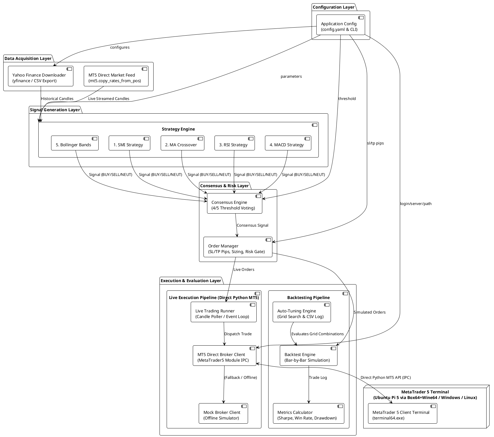
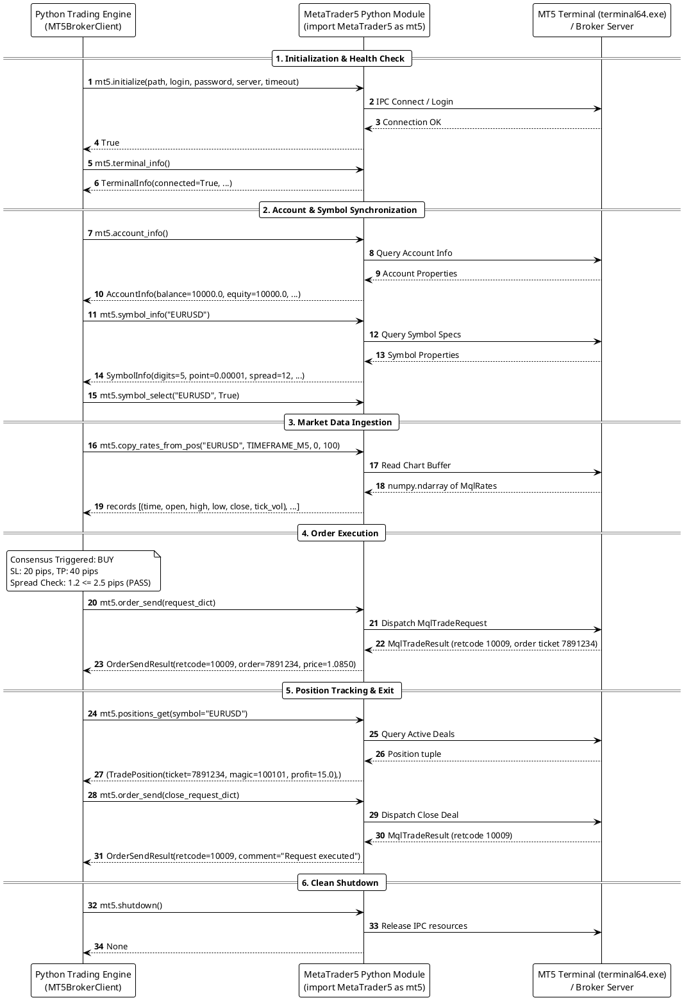
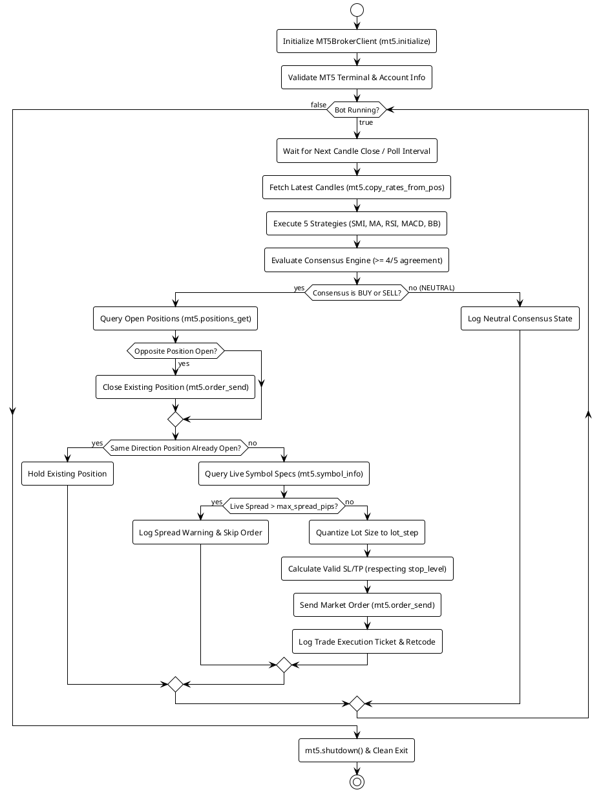

# Design Document: Forex Trading Signal System

## Architecture Overview

The Forex Trading Signal System follows a modular pipeline architecture with strict separation between data acquisition, signal generation, consensus decision-making, order management, backtesting/performance analysis, and live MetaTrader 5 broker execution.

### High-Level Architecture (Direct MetaTrader 5 Python Module Integration)



---

## Package Structure

```
trading/
├── pyproject.toml
├── config.yaml                       # Default application & MT5 configuration
├── requirements.md                   # Requirements specification
├── README.md                         # Project documentation & MT5 setup guide
├── src/
│   └── forex_signals/
│       ├── __init__.py
│       ├── cli.py                    # CLI entry points (backtest, live)
│       ├── config.py                 # Configuration models, validation & YAML loading
│       ├── data/
│       │   ├── __init__.py
│       │   ├── models.py             # Timeframe, Signal, Candle, OrderStatus
│       │   └── downloader.py         # Yahoo Finance data fetcher & CSV export
│       ├── strategies/
│       │   ├── __init__.py
│       │   ├── base.py               # Strategy protocol interface
│       │   ├── smi.py                # Stochastic Momentum Index
│       │   ├── moving_average.py      # Moving Average crossover
│       │   ├── rsi.py                # Relative Strength Index
│       │   ├── macd.py                # MACD oscillator
│       │   └── bollinger.py          # Bollinger Bands breakout/reversal
│       ├── consensus/
│       │   ├── __init__.py
│       │   └── engine.py             # Consensus voting logic
│       ├── orders/
│       │   ├── __init__.py
│       │   ├── models.py             # Order, Position models
│       │   └── manager.py            # Order lifecycle & SL/TP price calculator
│       ├── backtest/
│       │   ├── __init__.py
│       │   ├── engine.py             # Backtest orchestrator
│       │   ├── metrics.py            # Performance metrics calculator
│       │   └── tuner.py              # Grid search auto-tuner & CSV persistence
│       └── broker/
│           ├── __init__.py
│           ├── base.py               # Broker protocol & interface
│           ├── models.py             # Account, symbol, position, execution models
│           ├── mt5_client.py         # Direct MetaTrader5 Python module client
│           ├── live_runner.py        # Live trading synchronization & execution loop
│           └── mock.py               # Mock broker for offline/CI testing
└── tests/
    ├── conftest.py
    ├── test_strategies/              # Unit & property tests for strategies
    ├── test_consensus/               # Consensus voting tests
    ├── test_orders/                  # Order management & SL/TP calculation tests
    ├── test_backtest/                # Backtesting engine & auto-tuner tests
    ├── test_metrics/                 # Performance metric accuracy tests
    ├── test_broker/                  # MT5 direct client, mock broker & live loop tests
    ├── test_config/                  # Config parsing & validation tests
    ├── test_data/                    # Downloader & CSV export tests
    └── test_cli/                     # CLI command integration tests
```

---

## Data Models

```python
from dataclasses import dataclass, field
from datetime import datetime
from enum import Enum
from typing import Any, Dict, List, Optional


class Timeframe(Enum):
    M1 = "1m"
    M5 = "5m"
    M15 = "15m"
    M30 = "30m"
    H1 = "1h"
    H4 = "4h"
    D1 = "1d"


class Signal(Enum):
    BUY = "BUY"
    SELL = "SELL"
    NEUTRAL = "NEUTRAL"


class OrderStatus(Enum):
    PENDING = "PENDING"
    OPEN = "OPEN"
    CLOSED_TP = "CLOSED_TP"
    CLOSED_SL = "CLOSED_SL"
    CLOSED_SIGNAL = "CLOSED_SIGNAL"
    CLOSED_MANUAL = "CLOSED_MANUAL"
    CANCELLED = "CANCELLED"


@dataclass(frozen=True)
class Candle:
    timestamp: datetime
    open: float
    high: float
    low: float
    close: float
    volume: float


@dataclass(frozen=True)
class StrategySignal:
    strategy_name: str
    signal: Signal
    timestamp: datetime


@dataclass
class Order:
    direction: Signal  # BUY or SELL
    entry_price: float
    stop_loss: float
    take_profit: float
    entry_time: datetime
    lot_size: float = 0.1
    ticket: Optional[int] = None
    magic_number: Optional[int] = None
    exit_time: Optional[datetime] = None
    exit_price: Optional[float] = None
    status: OrderStatus = OrderStatus.OPEN
    pnl: Optional[float] = None
    pnl_pips: Optional[float] = None
    comment: str = ""


@dataclass(frozen=True)
class BacktestConfig:
    pair: str
    timeframe: Timeframe
    sl_pips: float
    tp_pips: float
    start_date: datetime
    end_date: datetime


@dataclass(frozen=True)
class BacktestResult:
    trades: List[Order]
    win_rate: float
    total_pnl: float
    max_drawdown: float
    sharpe_ratio: float
    profit_factor: float
    avg_trade_duration_seconds: float
    num_trades: int


# --- MT5 & Live Trading Models ---

class BrokerType(Enum):
    MT5 = "mt5"
    MOCK = "mock"


@dataclass(frozen=True)
class AccountInfo:
    login: int
    server: str
    currency: str
    balance: float
    equity: float
    margin: float
    free_margin: float
    leverage: int


@dataclass(frozen=True)
class SymbolInfo:
    name: str
    digits: int
    point: float
    pip_size: float
    spread_points: int
    spread_pips: float
    min_lot: float
    max_lot: float
    lot_step: float
    stop_level_points: int
    trade_contract_size: float


@dataclass
class Position:
    ticket: int
    symbol: str
    direction: Signal
    volume: float
    open_price: float
    stop_loss: float
    take_profit: float
    open_time: datetime
    current_price: float
    profit: float
    magic: int
    comment: str


@dataclass(frozen=True)
class TradeExecutionResult:
    success: bool
    retcode: int
    ticket: Optional[int]
    order_id: Optional[str]
    price: float
    volume: float
    timestamp: datetime
    error_message: str = ""
```

---

## Direct MetaTrader 5 Python Module Integration Design

### Direct MT5 API Architecture

The application communicates directly with MetaTrader 5 using the official `MetaTrader5` Python package (`import MetaTrader5 as mt5`).

On **Ubuntu on Raspberry Pi 5 (ARM64)**, MT5 and Python run inside a lightweight Box64 + Wine64 execution layer (or containerized headless virtual desktop with Xvfb), interacting directly via the MT5 C-extension / IPC channel with `terminal64.exe`.



---

## Component Interfaces & Design

### 1. Unified Broker Protocol

```python
from typing import Protocol, List, Optional

class Broker(Protocol):
    """Unified broker abstraction supporting direct MT5 module and mock execution."""

    def connect(self) -> bool:
        """Initialize connection to broker via mt5.initialize()."""
        ...

    def disconnect(self) -> None:
        """Clean shutdown and release resources via mt5.shutdown()."""
        ...

    def is_connected(self) -> bool:
        """Check current connection health via mt5.terminal_info()."""
        ...

    def get_account_info(self) -> AccountInfo:
        """Retrieve real-time account balances and equity via mt5.account_info()."""
        ...

    def get_symbol_info(self, symbol: str) -> SymbolInfo:
        """Query symbol specifications (digits, point, spread, lot constraints) via mt5.symbol_info()."""
        ...

    def get_candles(self, symbol: str, timeframe: Timeframe, count: int) -> List[Candle]:
        """Fetch latest candles via mt5.copy_rates_from_pos()."""
        ...

    def place_order(
        self,
        symbol: str,
        direction: Signal,
        volume: float,
        sl_price: float,
        tp_price: float,
        deviation: int = 10,
        magic: int = 100101,
        comment: str = "forex_signals_bot"
    ) -> TradeExecutionResult:
        """Dispatch market order via mt5.order_send()."""
        ...

    def close_position(self, ticket: int, deviation: int = 10) -> TradeExecutionResult:
        """Close open position by ticket via mt5.order_send()."""
        ...

    def get_open_positions(self, magic: Optional[int] = None) -> List[Position]:
        """List active positions filtered by magic number via mt5.positions_get()."""
        ...
```

### 2. Direct MT5 Broker Client (`MT5BrokerClient` in `src/forex_signals/broker/mt5_client.py`)

- Implements `Broker` interface calling `MetaTrader5` module functions directly.
- Handles initialization parameter passing (`path`, `login`, `password`, `server`, `timeout`).
- Maps raw MT5 rate numpy recarrays to internal `List[Candle]`.
- Assembles `MqlTradeRequest` dictionaries for market orders and position closes.
- Implements comprehensive error handling with `mt5.last_error()`.

### 3. Mock Broker Client (`MockBrokerClient` in `src/forex_signals/broker/mock.py`)

- Pure Python in-memory broker implementation for offline testing, property testing, and CI pipelines without requiring MT5 or Wine to be running.
- Simulates account balance, order fills, intrabar tick movements, SL/TP triggers, spread checks, and position tracking.

### 4. Live Trading Loop (`LiveTradingEngine` in `src/forex_signals/broker/live_runner.py`)

- Synchronizes execution cycle with bar close intervals (e.g. at the close of every 5-minute candle).



- Cycle steps:
  1. Fetch latest candles from MT5 via `broker.get_candles(...)`.
  2. Run 5 technical strategies (`SMI`, `MA`, `RSI`, `MACD`, `Bollinger`).
  3. Evaluate consensus agreement against threshold (default: 4/5).
  4. Query current open positions:
     - If opposite consensus occurs, close existing position.
     - If consensus matches direction and position already open, maintain position.
     - If consensus triggers and no open position exists:
       a. Check spread guardrail: if spread in pips > `max_spread_pips`, skip with warning log.
       b. Quantize volume to broker `lot_step` within `[min_lot, max_lot]`.
       c. Calculate SL/TP respecting broker `stop_level`.
       d. Send order via `broker.place_order(...)` and log ticket.
  5. Sleep until next candle close or tick polling interval.

---

## Configuration Schema (`config.yaml`)

```yaml
# General & Market Data Configuration
pair: "EURUSD=X"
timeframe: "M5"
sl_pips: 20.0
tp_pips: 40.0
consensus_threshold: 4

# Technical Strategy Parameters
strategies:
  smi:
    period: 14
    smooth_period: 3
  moving_average:
    fast_period: 10
    slow_period: 50
  rsi:
    period: 14
    overbought: 70
    oversold: 30
  macd:
    fast_period: 12
    slow_period: 26
    signal_period: 9
  bollinger:
    period: 20
    std_dev: 2.0

# Historical Backtest Window
backtest:
  start_date: "2026-06-01"
  end_date: "2026-07-29"

# CSV Data Export Configuration
csv_export:
  enabled: false
  output_dir: "data"

# Auto-Tuning Configuration
auto_tune:
  enabled: false
  train_split: 0.7
  consensus_threshold_values: [2, 3, 4, 5]
  strategy_param_values:
    moving_average:
      fast_period: [5, 10, 15]
      slow_period: [30, 50, 100]

# MetaTrader 5 Live Trading Configuration (Direct Python Module)
mt5:
  enabled: false
  mock: false                         # Set true for offline simulation without MT5
  path: ""                            # Optional path to terminal64.exe (e.g. in Wine on Ubuntu Pi 5)
  login: 0                            # MT5 account login number (optional if saved in terminal)
  password: ""                        # MT5 account password
  server: ""                          # MT5 broker server name
  symbol: "EURUSD"                   # MT5 symbol name (e.g. EURUSD, EURUSDm)
  lot_size: 0.1                      # Trade volume
  magic_number: 100101               # Magic number identifying bot trades
  max_spread_pips: 2.5               # Maximum allowable spread filter
  deviation_points: 10               # Max allowable slippage in points
  poll_interval_seconds: 5           # Polling interval between candle checks
  timeout_ms: 5000                   # MT5 initialization timeout in milliseconds
```

---

## Correctness Properties & Formal Specifications

### Property 1: Strategy signal validity
*For any* valid OHLC candle sequence with length $\ge \text{min\_candles}$ and *for any* strategy, `generate_signal` SHALL return exactly one of `Signal.BUY`, `Signal.SELL`, or `Signal.NEUTRAL` without raising an exception.
**Validates: Requirements FR2.1, FR2.2, FR2.3, FR2.4, FR2.5, FR2.6**

### Property 2: Consensus threshold correctness
*For any* list of 5 strategy signals, the consensus engine SHALL return `Signal.BUY` if and only if $\text{count}(\text{BUY}) \ge \text{threshold}$, SHALL return `Signal.SELL` if and only if $\text{count}(\text{SELL}) \ge \text{threshold}$, and SHALL return `Signal.NEUTRAL` in all other cases.
**Validates: Requirements FR3.2, FR3.3**

### Property 3: Consensus symmetry (equal weight)
*For any* list of strategy signals and *for any* permutation of those signals, the consensus engine SHALL produce the exact same output.
**Validates: Requirements FR3.1**

### Property 4: Stop-loss and take-profit price calculation
*For any* entry price, positive SL pip value, and positive TP pip value:
- BUY order: $\text{stop\_loss} < \text{entry\_price} < \text{take\_profit}$
- SELL order: $\text{take\_profit} < \text{entry\_price} < \text{stop\_loss}$
- Distance from entry to SL equals $\text{sl\_pips} \times \text{pip\_value}$
- Distance from entry to TP equals $\text{tp\_pips} \times \text{pip\_value}$
**Validates: Requirements FR4.2**

### Property 5: Order lifecycle state machine
*For any* open order and subsequent candle:
- BUY closes at SL if $\text{candle.low} \le \text{stop\_loss}$; closes at TP if $\text{candle.high} \ge \text{take\_profit}$.
- SELL closes at SL if $\text{candle.high} \ge \text{stop\_loss}$; closes at TP if $\text{candle.low} \le \text{take\_profit}$.
- Once closed, order status SHALL never transition back to open.
**Validates: Requirements FR4.3**

### Property 6: Win rate metric correctness
*For any* non-empty list of closed trades, $\text{win\_rate} = \frac{\text{count}(\text{pnl} > 0)}{\text{total\_trades}} \in [0.0, 1.0]$.
**Validates: Requirements FR5.2**

### Property 7: Max drawdown non-negativity and correctness
*For any* trade sequence, max drawdown SHALL be non-negative and equal $\max(\text{peak} - \text{trough})$ on cumulative equity.
**Validates: Requirements FR5.2**

### Property 8: Profit factor correctness
*For any* trade list, $\text{profit\_factor} = \frac{\sum_{\text{pnl}>0} \text{pnl}}{\left|\sum_{\text{pnl}<0} \text{pnl}\right|}$. Returns $\infty$ if no losses, $0.0$ if no wins.
**Validates: Requirements FR5.2**

### Property 9: Total PnL additivity
*For any* partition of trades $A$ and $B$, $\text{total\_pnl}(A + B) = \text{total\_pnl}(A) + \text{total\_pnl}(B)$.
**Validates: Requirements FR5.2**

### Property 10: Sharpe ratio formula correctness
*For any* trade returns with $N \ge 2$ and $\sigma > 0$, $\text{Sharpe} = \frac{\mu - r_f}{\sigma}$; otherwise $0.0$.
**Validates: Requirements FR5.2**

### Property 11: MT5 SL/TP distance and minimum stop level compliance
*For any* MT5 order request, calculated SL and TP price levels SHALL satisfy both the requested pip distance and exceed the broker's minimum `stop_level` distance:
$$|\text{entry} - \text{SL}| \ge \text{stop\_level\_points} \times \text{point} \quad \text{and} \quad |\text{entry} - \text{TP}| \ge \text{stop\_level\_points} \times \text{point}$$
**Validates: Requirements FR7.4**

### Property 12: MT5 lot size quantization
*For any* calculated lot size, the executed volume SHALL be clamped to $[\text{min\_lot}, \text{max\_lot}]$ and quantized to an exact multiple of $\text{lot\_step}$.
**Validates: Requirements FR7.2**

### Property 13: Spread filter order gatekeeping
*For any* live signal, if $\text{current\_spread\_pips} > \text{max\_spread\_pips}$, the trade request SHALL be rejected and no order shall be dispatched to the broker.
**Validates: Requirements FR7.6**

### Property 14: MT5 order ticket tracking and bot isolation
*For any* order dispatched to MT5, it SHALL carry the configured `magic_number`, and only positions matching this `magic_number` SHALL be queried or closed by the bot.
**Validates: Requirements FR7.4, FR7.5**
