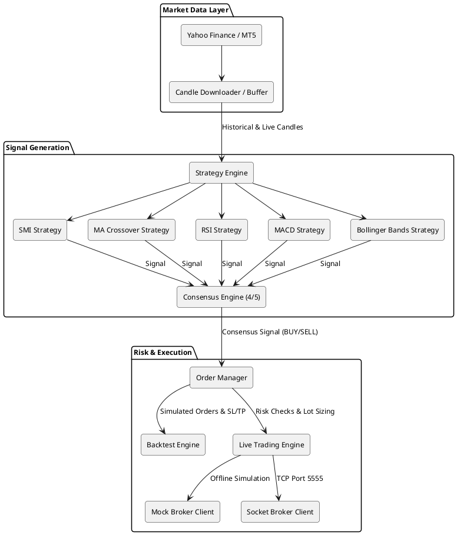
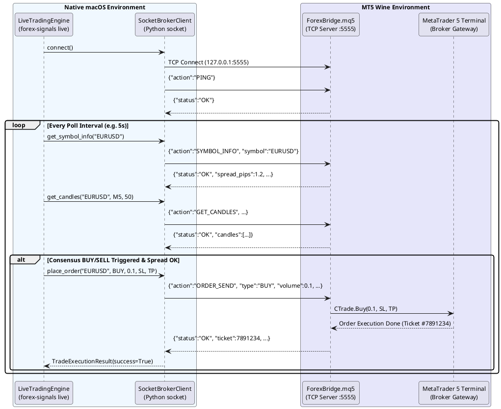

# Forex Trading Signal System

A modular, production-ready Python algorithmic trading application that downloads forex market data, evaluates 5 independent technical analysis strategies, and generates trade signals when a configurable consensus (default: 4 out of 5 strategies) agree on market direction.

The system supports:
1. **Historical Backtesting** — bar-by-bar trade simulation, intrabar SL/TP evaluation, and performance metrics (Sharpe ratio, max drawdown, win rate, profit factor).
2. **Strategy Auto-Tuning** — grid search optimization over consensus thresholds and strategy parameters with training splits and incremental CSV logging.
3. **Live & Demo Trading via MetaTrader 5 (MT5)** — automated live execution on macOS and Windows using a **Local TCP Socket Bridge (Method A)** or an in-memory **Mock Broker** for offline simulation.



---


## Key Features

- **Multi-Source Market Data**:
  - Historical OHLC candlestick data downloaded from Yahoo Finance via `yfinance` with exponential backoff retry and gap detection.
  - Live tick and bar data streaming directly from MetaTrader 5.
  - Optional CSV persistence (`data/<pair>_<timeframe>_<start>_<end>.csv`).
- **5 Technical Analysis Strategies**:
  - **SMI (Stochastic Momentum Index)** — double smoothed momentum oscillator.
  - **Moving Average Crossover** — fast/slow SMA/EMA trend detection (golden / death cross).
  - **RSI (Relative Strength Index)** — 14-period Wilder oversold/overbought mean reversion.
  - **MACD (Moving Average Convergence Divergence)** — standard 12/26/9 signal line crossover.
  - **Bollinger Bands** — 20-period 2.0 standard deviation dynamic channel reversal.
- **Consensus Decision Engine**:
  - Equal-weighted voting requiring $N/5$ agreement (default: 4 out of 5 strategies) to trigger trade entries.
- **Order & Risk Management**:
  - Configurable stop-loss and take-profit distances in pips.
  - Volume quantization clamped to broker `min_lot`, `max_lot`, and rounded to `lot_step`.
  - Broker `stoplevel` minimum distance compliance for SL and TP levels.
  - Real-time spread guardrail: rejects trade entries if live spread exceeds `max_spread_pips`.
- **Backtesting & Auto-Tuning Engine**:
  - Bar-by-bar historical simulation with intrabar high/low fill validation.
  - Metrics: Total/Net P&L, Win Rate, Max Drawdown, Sharpe Ratio, Profit Factor, Average Trade Duration.
  - Grid search auto-tuning with train/validation splitting, resume caching, and progress reporting.
- **MetaTrader 5 Live Trading (Method A: Local TCP Socket Bridge)**:
  - Native macOS Python execution connecting via TCP (`127.0.0.1:5555`) to MT5 running on macOS (or Windows) with `ForexBridge.mq5`.
  - Zero Wine CLI friction for Python commands.
  - Full position lifecycle tracking, magic number isolation, and automated exits on opposite consensus signals.

---

## Requirements

- Python >= 3.10
- MetaTrader 5 (optional, only required for live broker trading)

---

## Installation

Clone the repository and install the package in editable mode within a virtual environment:

### macOS / Linux

```bash
cd trading

# Create and activate a virtual environment
python3 -m venv .venv
source .venv/bin/activate

# Upgrade pip and install package
python3 -m pip install --upgrade pip
python3 -m pip install -e .

# Install development & test dependencies (pytest, hypothesis, etc.)
python3 -m pip install -e ".[dev]"
```

### Windows

```powershell
cd trading

# Create and activate virtual environment in PowerShell
python -m venv .venv
.venv\Scripts\Activate.ps1

# Upgrade pip and install package
python -m pip install --upgrade pip
python -m pip install -e .
python -m pip install -e ".[dev]"
```

---

## Configuration (`config.yaml`)

Application settings are managed in [config.yaml](config.yaml):

```yaml
# General & Currency Pair Settings
pair: "EURUSD=X"
timeframe: "M5"
sl_pips: 20
tp_pips: 40
consensus_threshold: 4

# Technical Strategy Parameters
strategies:
  smi:
    period: 14
    smooth_period: 3
  moving_average:
    fast_period: 10
    slow_period: 50
  rsi:
    period: 14
    overbought: 70
    oversold: 30
  macd:
    fast_period: 12
    slow_period: 26
    signal_period: 9
  bollinger:
    period: 20
    std_dev: 2.0

# Historical Backtest Date Range
backtest:
  start_date: "2026-06-01"
  end_date: "2026-07-29"

# CSV Data Export Settings
csv_export:
  enabled: true
  output_dir: "data"

# Auto-Tuning Configuration
auto_tune:
  enabled: false
  train_split: 0.7
  consensus_threshold_values: [2, 3, 4, 5]
  strategy_param_values:
    smi:
      period: [7, 14]
      smooth_period: [2, 3]
    moving_average:
      fast_period: [5, 10]
      slow_period: [20, 50]

# MetaTrader 5 Live Trading (Method A: Local TCP Socket Bridge)
mt5:
  enabled: false
  mock: false                         # Set true for offline simulation without MT5
  host: "127.0.0.1"                  # Host where MT5 ForexBridge.mq5 is running
  port: 5555                         # Port configured in ForexBridge.mq5 EA
  symbol: "EURUSD"                   # MT5 symbol name
  lot_size: 0.1                      # Order volume in lots
  magic_number: 100101               # Magic number identifying bot trades
  max_spread_pips: 2.5               # Maximum allowable spread filter (pips)
  deviation_points: 10               # Slippage deviation in points
  poll_interval_seconds: 5           # Polling frequency in seconds
  timeout_seconds: 5.0               # Socket request timeout
```

### Configuration Reference

| Section / Key | Type | Default | Description |
| :--- | :--- | :--- | :--- |
| `pair` | `string` | `EURUSD=X` | Yahoo Finance ticker symbol |
| `timeframe` | `string` | `M5` | Timeframe interval (`M1`, `M5`, `M15`, `M30`, `H1`, `H4`, `D1`) |
| `sl_pips` / `tp_pips` | `float` | `20` / `40` | Stop-loss / take-profit distance in pips |
| `consensus_threshold` | `int` | `4` | Minimum agreeing strategies (1–5) needed for a signal |
| `strategies` | `map` | — | Per-strategy parameter configurations |
| `backtest.start_date` / `end_date` | `string` | — | Historical date window (`YYYY-MM-DD`) |
| `csv_export.enabled` | `bool` | `true` | Export downloaded candle data to local CSV |
| `auto_tune.enabled` | `bool` | `false` | Enable grid search auto-tuning |
| `auto_tune.train_split` | `float` | `0.7` | In-sample training partition ratio |
| `mt5.mock` | `bool` | `false` | Use in-memory mock broker instead of live MT5 socket |
| `mt5.host` / `mt5.port` | `string` / `int` | `127.0.0.1` / `5555` | Local TCP address of `ForexBridge.mq5` EA |
| `mt5.symbol` | `string` | `EURUSD` | Symbol name traded in MetaTrader 5 |
| `mt5.lot_size` | `float` | `0.1` | Order lot size |
| `mt5.magic_number` | `int` | `100101` | Magic number to isolate bot orders from manual trades |
| `mt5.max_spread_pips` | `float` | `2.5` | Spread safety limit in pips |

---

## CLI Usage

The system exposes two primary commands: `forex-signals backtest` and `forex-signals live`.

### 1. Backtesting

Run a backtest using settings from `config.yaml`:

```bash
forex-signals backtest
```

Override parameters directly via CLI flags:

```bash
forex-signals backtest \
  --config config.yaml \
  --pair EURUSD=X \
  --timeframe M5 \
  --sl-pips 25 \
  --tp-pips 50 \
  --start-date 2026-06-01 \
  --end-date 2026-07-29 \
  --save-csv \
  --csv-dir data
```

#### Example Output:

```
Downloading EURUSD=X data (M5) from 2026-06-01 to 2026-07-29...
Downloaded 11520 candles.
Candles exported to CSV: data/EURUSDX_M5_20260601_20260729.csv

==================================================
         BACKTEST RESULTS
==================================================

  Total Trades         │  48
  Win Rate             │  58.33%
  Total PnL            │  0.014200
  Max Drawdown         │  0.003150
  Sharpe Ratio         │  1.4250
  Profit Factor        │  1.8500
  Avg Trade Duration   │  3600s

==================================================
```

---

### 2. Auto-Tuning Strategy Parameters

Search for the optimal consensus threshold and strategy parameters:

```bash
forex-signals backtest --auto-tune
```

The auto-tuner tests candidate combinations on the training window, logs results incrementally to `data/auto_tune_results_<pair>.csv`, selects the best configuration by Sharpe ratio, and executes the final backtest.

---

### 3. Live Trading with MetaTrader 5 on macOS (Method A)

Run live or demo automated trading against your MetaTrader 5 terminal:



#### Step 1: Install MetaTrader 5 on Mac
Download and install MT5 for Mac from your broker or [MetaQuotes](https://www.metatrader5.com/en/download).

#### Step 2: Install `ForexBridge.mq5` Expert Advisor
1. In MT5 on Mac, click **File** -> **Open Data Folder**.
2. Open `MQL5/Experts/` and copy [`scripts/mt5/ForexBridge.mq5`](scripts/mt5/ForexBridge.mq5) into this folder.
3. Open the Navigator panel (`Cmd+N` or `Ctrl+N`), right-click **Expert Advisors** -> **Refresh**.
4. Drag `ForexBridge` onto any active chart (e.g. `EURUSD`).
5. Ensure **Allow Algo Trading** is enabled in the MT5 top toolbar and in the EA Properties dialog.

#### Step 3: Run Live Trading Command

Connect to the live MT5 terminal:

```bash
forex-signals live --config config.yaml --pair EURUSD --lot-size 0.1
```

Run an offline mock simulation (no MT5 required):

```bash
forex-signals live --mock --pair EURUSD --lot-size 0.1
```

#### Available `live` CLI Options:

| Option | Description |
| :--- | :--- |
| `--config` | Path to alternate YAML config file |
| `--pair` / `--symbol` | Trading symbol (e.g. `EURUSD`) |
| `--mock` / `--no-mock` | Run in-memory mock broker vs live MT5 socket bridge |
| `--host` / `--port` | MT5 socket bridge address (default: `127.0.0.1:5555`) |
| `--lot-size` | Order volume in lots |
| `--magic-number` | Bot magic number identifier |
| `--max-spread` | Maximum allowable spread filter (pips) |
| `--poll-interval` | Interval in seconds between market checks |
| `--max-iterations` | Terminate after $N$ polling iterations (useful for testing) |

---

## Project Structure

```
trading/
├── pyproject.toml                     # Package metadata, dependencies, entry points
├── config.yaml                        # Default configuration & MT5 socket settings
├── requirements.md                    # Requirements specification
├── README.md                          # Project documentation
├── scripts/
│   └── mt5/
│       └── ForexBridge.mq5            # MQL5 Expert Advisor socket server (Method A)
├── src/
│   └── forex_signals/
│       ├── __init__.py
│       ├── cli.py                     # CLI entry points (backtest, live)
│       ├── config.py                  # YAML config loading & validation
│       ├── data/
│       │   ├── __init__.py
│       │   ├── models.py              # Candle, Signal, Timeframe, OrderStatus
│       │   └── downloader.py          # Yahoo Finance fetcher & CSV exporter
│       ├── strategies/
│       │   ├── __init__.py
│       │   ├── base.py                # Strategy protocol
│       │   ├── smi.py                 # Stochastic Momentum Index
│       │   ├── moving_average.py       # MA crossover
│       │   ├── rsi.py                 # Relative Strength Index
│       │   ├── macd.py                # MACD oscillator
│       │   └── bollinger.py           # Bollinger Bands
│       ├── consensus/
│       │   ├── __init__.py
│       │   └── engine.py              # Consensus voting logic
│       ├── orders/
│       │   ├── __init__.py
│       │   ├── models.py              # Order dataclass
│       │   └── manager.py             # Order lifecycle management
│       ├── backtest/
│       │   ├── __init__.py
│       │   ├── engine.py              # Backtest engine simulator
│       │   ├── metrics.py             # Performance metric calculations
│       │   └── tuner.py               # Grid search parameter tuner
│       └── broker/
│           ├── __init__.py
│           ├── base.py                # Unified Broker protocol
│           ├── models.py              # AccountInfo, SymbolInfo, Position, TradeExecutionResult
│           ├── socket_client.py       # TCP socket client for macOS MT5 (Method A)
│           ├── live_runner.py         # Live trading execution loop & risk controls
│           └── mock.py                # Mock broker for offline simulation & CI
└── tests/
    ├── conftest.py                    # Shared pytest fixtures
    ├── test_strategies/               # Strategy unit & validation tests
    ├── test_consensus/                # Consensus voting logic tests
    ├── test_orders/                   # Order creation & SL/TP calculation tests
    ├── test_backtest/                 # Backtesting & auto-tuner tests
    ├── test_metrics/                  # Performance metric formula accuracy tests
    ├── test_broker/                   # Socket client, mock broker & property tests
    ├── test_data/                     # Downloader & CSV export tests
    ├── test_config/                   # Config validation tests
    └── test_cli/                      # CLI integration tests
```

---

## Testing

Run the full test suite (280+ unit, integration, and property-based tests):

```bash
pytest
```

Run specific test modules:

```bash
# Run broker tests (models, socket client, mock broker, live runner)
pytest tests/test_broker/ -v

# Run Hypothesis property-based tests (Properties 11-14)
pytest tests/test_broker/test_properties.py -v

# Run strategy tests
pytest tests/test_strategies/ -v
```

---

## Extending

- **Add a new strategy**: Implement the `Strategy` protocol in [`src/forex_signals/strategies/base.py`](src/forex_signals/strategies/base.py) (`name`, `generate_signal(candles)`, `min_candles`), register the factory in `_build_strategies()` in [`src/forex_signals/cli.py`](src/forex_signals/cli.py), and define default parameters in [`config.yaml`](config.yaml).
- **Custom Broker Connector**: Implement the `Broker` protocol in [`src/forex_signals/broker/base.py`](src/forex_signals/broker/base.py) to support alternative broker platforms (e.g. cTrader, Interactive Brokers, FIX API).
